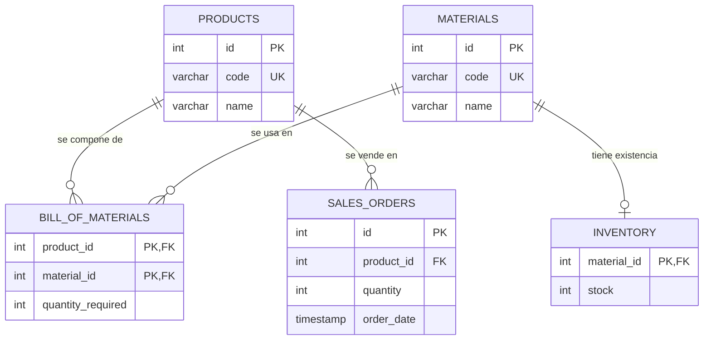

# Integridad estructural de la base de datos

**Archivos revisados:** `sql/init.sql`, `sql/seeds.sql`, `src/create_schema.py`

---

## 1. Objetivo de la integridad estructural

La integridad estructural busca que la base de datos del ERP solo pueda contener datos **válidos, completos y bien relacionados**. En este proyecto eso significa que:

- Cada producto, material y orden se identifique de forma única.
- No existan registros que apunten a productos o materiales inexistentes.
- Los campos obligatorios (códigos, nombres, cantidades, existencias) siempre tengan valor.
- El cálculo de faltantes (MRP) de `check_shortages.py` trabaje sobre datos confiables.

Si la estructura falla, el MRP puede calcular mal los materiales necesarios para fabricar las Gaming PCs, aunque el código Python esté correcto.

---

## 2. Estructura de las tablas

| Tabla | Propósito | Columnas |
| --- | --- | --- |
| `products` | Catálogo de productos terminados | `id`, `code`, `name` |
| `materials` | Catálogo de componentes o materia prima | `id`, `code`, `name` |
| `inventory` | Existencias por material | `material_id`, `stock` |
| `bill_of_materials` | Lista de materiales (BOM): qué y cuánto lleva cada producto | `product_id`, `material_id`, `quantity_required` |
| `sales_orders` | Órdenes de venta que generan la demanda | `id`, `product_id`, `quantity`, `order_date` |

Detalle de tipos y restricciones:

| Tabla | Columna | Tipo | Restricciones |
| --- | --- | --- | --- |
| products | id | SERIAL | PRIMARY KEY |
| products | code | VARCHAR(20) | UNIQUE, NOT NULL |
| products | name | VARCHAR(100) | NOT NULL |
| materials | id | SERIAL | PRIMARY KEY |
| materials | code | VARCHAR(20) | UNIQUE, NOT NULL |
| materials | name | VARCHAR(100) | NOT NULL |
| inventory | material_id | INTEGER | PRIMARY KEY, FOREIGN KEY → materials(id) |
| inventory | stock | INTEGER | NOT NULL |
| bill_of_materials | product_id | INTEGER | PK compuesta, FOREIGN KEY → products(id) |
| bill_of_materials | material_id | INTEGER | PK compuesta, FOREIGN KEY → materials(id) |
| bill_of_materials | quantity_required | INTEGER | NOT NULL |
| sales_orders | id | SERIAL | PRIMARY KEY |
| sales_orders | product_id | INTEGER | NOT NULL, FOREIGN KEY → products(id) |
| sales_orders | quantity | INTEGER | NOT NULL |
| sales_orders | order_date | TIMESTAMP | DEFAULT CURRENT_TIMESTAMP |

---

## 3. Uso de llaves primarias (PRIMARY KEY)

- **`products.id`, `materials.id` y `sales_orders.id`** usan `SERIAL PRIMARY KEY`: identificadores numéricos autoincrementales, únicos y no nulos.
- **`inventory.material_id`** es llave primaria y a la vez foránea. Esto garantiza que cada material tenga **como máximo un** registro de inventario (relación 1:1).
- **`bill_of_materials (product_id, material_id)`** es una llave primaria **compuesta**. Impide que un mismo material aparezca dos veces en la BOM del mismo producto, evitando que se sume doble al calcular requerimientos.

Al ser parte de la llave primaria, `product_id` y `material_id` en `bill_of_materials` son implícitamente `NOT NULL`, aunque no se declare.

---

## 4. Uso de llaves foráneas (FOREIGN KEY)

| Tabla hija | Columna | Referencia | Qué garantiza |
| --- | --- | --- | --- |
| inventory | material_id | materials(id) | No hay inventario de materiales inexistentes |
| bill_of_materials | product_id | products(id) | La BOM solo describe productos reales |
| bill_of_materials | material_id | materials(id) | La BOM solo usa materiales reales |
| sales_orders | product_id | products(id) | No se pueden vender productos inexistentes |

Ninguna llave foránea define `ON DELETE` ni `ON UPDATE`, así que PostgreSQL aplica el comportamiento por defecto (`NO ACTION`): **no permite borrar** un producto o material que siga referenciado. Esto protege los datos, pero la política no está documentada en el esquema.

---

## 5. Restricciones UNIQUE y NOT NULL

**UNIQUE**
- `products.code` y `materials.code` son únicos, así que no puede haber dos productos `PC001` ni dos materiales `CPU001`.
- Los nombres (`name`) **no** son únicos, lo cual es razonable, pero permite dos materiales distintos con el mismo nombre.

**NOT NULL**
- Obligatorios: `code` y `name` en catálogos, `stock`, `quantity_required`, `product_id` y `quantity` en órdenes.
- `sales_orders.order_date` tiene valor por defecto, pero **no** es `NOT NULL`; un `INSERT` explícito con `NULL` dejaría la orden sin fecha.

**Lo que falta:** no existen restricciones `CHECK`, por lo que se aceptan cantidades en cero o negativas.

---

## 6. Relaciones entre entidades



- **Productos ↔ Materiales: muchos a muchos (N:M)**, resuelta con la tabla intermedia `bill_of_materials`. Ejemplo: la Gaming PC lleva 2 RAM y 1 de cada otro componente.
- **Materiales → Inventario: uno a cero o uno (1:0..1).** Un material puede no tener registro de inventario.
- **Productos → Órdenes de venta: uno a muchos (1:N).**

Flujo del MRP: `sales_orders.quantity × bill_of_materials.quantity_required` se compara contra `inventory.stock` para detectar faltantes.

---

## 7. Riesgos de registros duplicados, incompletos o mal relacionados

### Duplicados
- **Códigos con distinto formato:** `UNIQUE` distingue mayúsculas y espacios, así que `CPU001`, `cpu001` y `CPU001 ` se consideran distintos.
- **Seeds ejecutados dos veces:** `seeds.sql` usa `INSERT` simples. Una segunda ejecución falla por el `UNIQUE` de `code`; si se quitara esa restricción, se duplicaría el catálogo.
- **`init.sql` sin `IF NOT EXISTS`:** al correr `create_schema.py` sobre una base existente, falla con "relation already exists".

### Incompletos
- **Materiales sin inventario:** nada obliga a crear la fila en `inventory`. El MRP podría ignorar ese material o tratarlo como si no existiera.
- **Productos sin BOM:** se pueden registrar órdenes de un producto que no tiene lista de materiales, y el MRP no calcularía ningún requerimiento.
- **Órdenes sin fecha:** `order_date` acepta `NULL` explícito.

### Mal relacionados o inválidos
- **IDs fijos en `seeds.sql`:** inventario y BOM usan `1, 2, 3…` asumiendo el orden en que `SERIAL` asignó los IDs. Si cambia el orden de inserción, o la secuencia no empieza en 1, la RAM podría quedar con el stock del CPU sin que la base marque error.
- **Cantidades inválidas:** `stock` negativo, `quantity_required = 0` o `quantity` negativa son aceptados y distorsionan el MRP.
- **Política de borrado implícita:** al no declarar `ON DELETE`, no queda claro qué debe pasar con la BOM al eliminar un producto.

### En `create_schema.py`
- Las credenciales están **fijas en el código** (`localhost`, `erp`/`erp`) e ignoran las variables de entorno del `.env.example` y del workflow (`POSTGRES_HOST`, etc.).
- No hay manejo de errores ni `rollback` explícito, y la conexión no se cierra si ocurre una excepción.

---

## 8. Propuestas para fortalecer la integridad referencial

### 8.1 Validar valores con `CHECK`
```sql
ALTER TABLE inventory
    ADD CONSTRAINT chk_inventory_stock CHECK (stock >= 0);

ALTER TABLE bill_of_materials
    ADD CONSTRAINT chk_bom_quantity CHECK (quantity_required > 0);

ALTER TABLE sales_orders
    ADD CONSTRAINT chk_order_quantity CHECK (quantity > 0);
```

### 8.2 Normalizar códigos y evitar duplicados por formato
```sql
ALTER TABLE products
    ADD CONSTRAINT chk_products_code CHECK (code = UPPER(TRIM(code)));

ALTER TABLE materials
    ADD CONSTRAINT chk_materials_code CHECK (code = UPPER(TRIM(code)));
```

### 8.3 Declarar explícitamente la política de borrado
```sql
-- Si se elimina un producto, su BOM ya no tiene sentido
FOREIGN KEY (product_id) REFERENCES products(id) ON DELETE CASCADE

-- No se debe borrar un producto que ya tiene ventas
FOREIGN KEY (product_id) REFERENCES products(id) ON DELETE RESTRICT

-- No se debe borrar un material que está en inventario o en una BOM
FOREIGN KEY (material_id) REFERENCES materials(id) ON DELETE RESTRICT
```

### 8.4 Hacer obligatoria la fecha de la orden
```sql
ALTER TABLE sales_orders
    ALTER COLUMN order_date SET NOT NULL;
```

### 8.5 Seeds sin IDs fijos e idempotentes
Buscar los IDs por código en lugar de suponerlos, y evitar errores al repetir la carga:
```sql
INSERT INTO materials (code, name)
VALUES ('CPU001', 'CPU Ryzen 7')
ON CONFLICT (code) DO NOTHING;

INSERT INTO inventory (material_id, stock)
SELECT id, 50 FROM materials WHERE code = 'CPU001'
ON CONFLICT (material_id) DO NOTHING;

INSERT INTO bill_of_materials (product_id, material_id, quantity_required)
SELECT p.id, m.id, 2
FROM products p, materials m
WHERE p.code = 'PC001' AND m.code = 'RAM001'
ON CONFLICT (product_id, material_id) DO NOTHING;
```

### 8.6 Esquema re-ejecutable
```sql
CREATE TABLE IF NOT EXISTS products ( ... );
```

### 8.7 Garantizar inventario para cada material
Un trigger que cree el registro de inventario en cero al dar de alta un material:
```sql
CREATE OR REPLACE FUNCTION fn_create_inventory()
RETURNS TRIGGER AS $$
BEGIN
    INSERT INTO inventory (material_id, stock)
    VALUES (NEW.id, 0)
    ON CONFLICT (material_id) DO NOTHING;
    RETURN NEW;
END;
$$ LANGUAGE plpgsql;

CREATE TRIGGER trg_material_inventory
AFTER INSERT ON materials
FOR EACH ROW EXECUTE FUNCTION fn_create_inventory();
```

### 8.8 Índices en llaves foráneas
PostgreSQL no indexa automáticamente las llaves foráneas. Estos índices aceleran las validaciones y los joins del MRP:
```sql
CREATE INDEX IF NOT EXISTS idx_bom_material ON bill_of_materials(material_id);
CREATE INDEX IF NOT EXISTS idx_orders_product ON sales_orders(product_id);
```

### 8.9 Mejorar `create_schema.py`
Leer credenciales del entorno y asegurar el `rollback` ante errores:
```python
import os
import psycopg2

conn = psycopg2.connect(
    host=os.getenv("POSTGRES_HOST", "localhost"),
    port=os.getenv("POSTGRES_PORT", "5432"),
    database=os.getenv("POSTGRES_DB", "erpdb"),
    user=os.getenv("POSTGRES_USER", "erp"),
    password=os.getenv("POSTGRES_PASSWORD", "erp"),
)

try:
    with conn.cursor() as cursor, open("sql/init.sql", "r") as f:
        cursor.execute(f.read())
    conn.commit()
    print("Schema created")
except Exception as error:
    conn.rollback()
    print(f"Error creating schema: {error}")
    raise
finally:
    conn.close()
```

---

## Conclusión

El esquema actual tiene una base sólida: llaves primarias en todas las tablas, llaves foráneas en todas las relaciones y códigos únicos en los catálogos. Sus principales debilidades son la **falta de validaciones `CHECK`**, los **IDs fijos en los seeds**, la **ausencia de una política de borrado explícita** y la posibilidad de **materiales sin inventario o productos sin BOM**. Aplicar las propuestas anteriores haría que la base rechace por sí misma los datos que hoy podrían hacer fallar el cálculo de faltantes del MRP.


Comentarios 
Para asegurar la integridad de las transacciones en nuestro ERP, es clave manejar bloques atómicos (BEGIN, COMMIT, ROLLBACK) desde Python para evitar que la base de datos quede a medias si algo falla, usar SELECT ... FOR UPDATE en el inventario para evitar que dos ventas al mismo tiempo alteren mal el stock (condiciones de carrera), y respaldarlo todo con restricciones CHECK en SQL para que la propia base rechace números negativos o datos corruptos aunque la aplicación falle.
